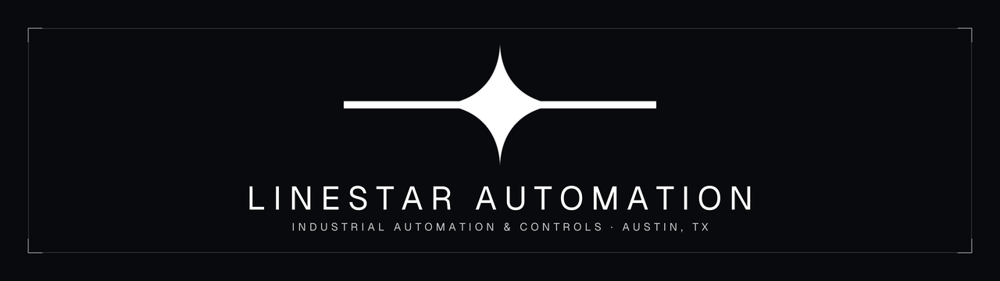

  

# Linestar Automation

**Industrial Automation & Controls Engineering · Austin, TX**

Linestar Automation is a design-build industrial automation and controls shop, and a DBA of **LSA Labs LLC**. We engineer custom machine controls, PLC/SCADA systems, and plant telemetry for manufacturers and machine builders.

The work is backed by **Frank Zeiler's 40+ years** of hands-on industrial automation, custom machine controls, PLC/SCADA, and instrumentation engineering, and by his leadership as **President of the [ISA Bluebonnet Section](https://connect.isa.org/communities/community-home?CommunityKey=1d16157a-fa10-41cc-8525-a17aaec80501)** (Central Texas).

## Three pillars

**1. Custom Machine Controls & PLC/SCADA Engineering**  
Rockwell/Allen-Bradley, Siemens, Beckhoff, and Yaskawa. OPC-UA, Modbus, and EtherNet/IP. Control panels designed to UL 508A standards, and legacy plant retrofits.

**2. Support / Monitor / Assure**  
Recurring plant telemetry, alarming, and remote diagnostics retainers for installed machines.

**3. AI-Assisted Commissioning & Diagnostics**  
Modern AI copilot workflows built on 40+ years of controls engineering expertise.

## Website

The public site is **[linestarautomation.com](https://linestarautomation.com)**. Source lives in [`linestar-automation/linestarautomation.com`](https://github.com/linestar-automation/linestarautomation.com).

[linestarautomation.com](https://linestarautomation.com) · [info@linestarautomation.com](mailto:info@linestarautomation.com)
